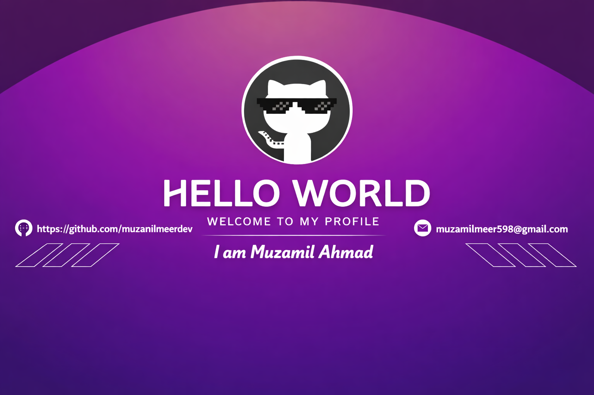

<!-- ================= HEADER ================= -->

 

 

---

<!-- ================= ABOUT ME ================= -->

## 👨‍💻 About Me

Hi! I'm **Muzamil**, a passionate developer from India who loves building modern, interactive and creative digital experiences.

* 🔭 Currently working on [Bandipora](https://bandipora-com.vercel.app/)
* 🌱 Learning Next.js, Tailwind CSS, GSAP, Three.js & FastAPI.
* 💻 Interested in Full-Stack Development.
* 🎨 Passionate about Creative UI/UX and 3D Web Experiences.
* 🤝 Open to interesting development collaborations.
* 💬 Ask me about React, GSAP, Three.js and API Integrations.
* 📫 Email: [muzamilmeer598@gmail.com](mailto:muzamilmeer598@gmail.com)

 

---

<!-- ================= TECH STACK ================= -->

## ⚡ Tech Stack & Tools

---

<!-- ================= PROJECTS ================= -->

## 🚀 Featured Projects

  

  

---

<!-- ================= LEARNING ================= -->

## 🎯 Currently Exploring

* Advanced GSAP Animations.
* Interactive 3D Web Development with Three.js.
* Modern React & Next.js Architecture.
* Backend Development with FastAPI.
* Cloud Computing & Deployment.

---

<!-- ================= TROPHIES ================= -->

## 🏆 GitHub Trophies

---

<!-- ================= GITHUB STATS ================= -->

## 📊 GitHub Statistics

  

---

<!-- ================= CONTRIBUTION GRAPH ================= -->

## 📈 Contribution Activity

---

<!-- ================= BLOGS ================= -->

## ✍️ Latest Blogs

---

<!-- ================= CONNECT ================= -->

## 🤝 Connect With Me

  

<a href="https://github.com/muzamilmeerdev">
<b>👨‍💻 github.com/muzamilmeerdev</b>
</a>

  

### 💡 "Turning Ideas Into Interactive Digital Experiences."

⭐ Thanks for visiting my profile!

<!-- ================= END ================= -->
